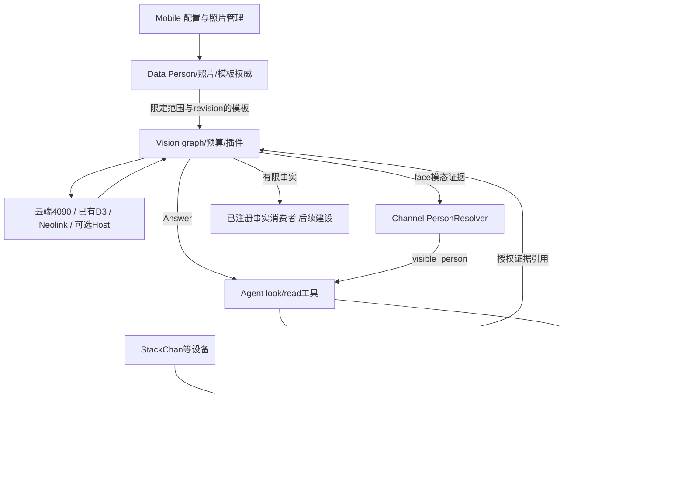

# Eidolon 视觉交互整体方案

日期：2026-11-05。状态：待评审设计，不是实施完成报告。综合 Vision 能力中心方案、Reachy 集成专项与当前 Person 约束。本轮未修改生产代码、连接机器人、运行模型或部署；云端部署偏好不等于本轮部署任务。

## 1. 总体决定

Eidolon 建设 client 无关的视觉能力中心，并由 Agent、Channel、Person 与设备行为层共同提供完整体验。能力中心允许设备观测、Host 推理和远端模型替换；新增模型优先用用户已有云端4090验证。Reachy 保留官方相机、检测、跟随和电机闭环。

优先交付两条独立链路：会话内“看着人”，以及“帮我看一下”。随后在 Person 专项允许进入人脸阶段时接通“认出可见的人”。主动问候需要新的会话编排与产品许可，ASD另立后续专题，不作为前两项的依赖。

## 2. 证据与合并裁决

输入材料：

- [原Vision能力中心方案](vision-capability-center-2026-10-31.md)：模型候选、证据契约、隔离、预算、4090路线。
- [Claude Code分析](/Users/manson/tmp/reachy-vision-face-integration-plan-20261105.md)：Reachy client、照片链路、分阶段建议。该材料的官方源码行号与机器人版本属于转述证据，不视为本轮真机核验。
- [Person复盘](../../../docs/跨系统/Person识别与按人数据-复盘与纠偏-20261031.md)：当前优先注册用户和共享记忆收敛；§3.9将人脸列为后续。

本轮再次阅读的工作区证据：

| 位置 | 确认的现状 | 影响 |
|---|---|---|
| [person_face.py](../../../eidolon_sdk/eidolon_sdk/biz/person_face.py) | recognition_state固定not_configured | 保存照片不能宣称识别可用 |
| [person_faces.py](../../../eidolon_data/eidolon_data/services/person_faces.py) | revision校验；替换/删除清空特征字段 | 注册任务须按revision写回 |
| [person_observation.py](../../../eidolon_sdk/eidolon_sdk/biz/person_observation.py) | face仅可visible_person，speaker仅voice，反馈租期不超过10秒 | 不能用脸直接替代本轮说话人 |
| [daemon_motion.py](../../../eidolon_client_reachy_mini/src/eidolon_platform_reachy/daemon_motion.py) | 会话开始和手势路径调用stop_head_tracking | 官方能力存在不等于Eidolon已经启用 |
| [media.py](../../../eidolon_client_reachy_mini/src/eidolon_platform_reachy/media.py) | read_audio/read_video共用capture worker | 新增取图先隔离阻塞与资源预算 |
| [RoomIO](../../../eidolon_channel/eidolon/livekit/agent/session/room_io.py) | video_input=False | 视频发布和消费需独立验收 |
| [capability_rpc.py](../../../eidolon_client_reachy_mini/src/eidolon_client/transport/livekit/capability_rpc.py) | 请求校验12000字节限额 | RPC只承载控制和引用，不塞图片 |
| [hub_ingress.py](../../eidolon_vision/adapters/sink/hub_ingress.py) | 仍投递/internal/sense/facts；本轮Hub搜索未找到同名路由 | 事实消费者未接通，不靠旧sink交付主动能力 |

合并时修正的判断：

1. “所有profile暴露跟随工具”不等于“默认自动开始跟随”。默认策略需由Eidolon明确。
2. 官方FaceTarget只有中心、roll、时间等信息，不能当作完整人脸框/稳定track_id；无需为复用这个接口而复制daemon检测器。
3. detected从false到true只是重新检测到，不保证换了一个人；多人位置关联也可能没有false就换目标。不得用这个边沿独自触发身份绑定。
4. 官方app姿态与daemon跟随可以按权重协调；“只有一个写入者”应限定到各自层，避免两个模块独立控制同一权重。不能简单禁止一切app姿态更新。
5. 官方1.14开发源码与材料所述机器人1.13.0不是等价运行证据。权重、刷新率、相机状态必须按实际版本验收。切换weight属于行为测试，不称为只读检查。
6. “不创建LOCAL消费者”不证明物理摄像头没有采集；隐私状态需区分硬件采集、应用读取、上传、识别四层。
7. Vision不是CPU限定服务；GPU工作进程可在4090。人脸匹配属于Vision模态计算，但Person权威始终归Data。
8. ASD不硬依赖身份注册；项目安排上延后。识别、主体关联和记忆授权是三件独立事情，完成ASD也不自动授予记忆访问。

## 3. 产品能力与当前范围

| 产品体验 | 核心结果 | 负责组合 | 顺序 |
|---|---|---|---|
| 看着人 | 当前目标位置与有效期，设备自然注视 | client行为层+官方跟随；其他设备可用Vision | 首期A |
| 帮我看一下 | 场景/物体问题回答 | Agent工具+Channel媒体+Vision VLM | 首期B |
| 读给我听 | 文字结果与必要区域证据 | 同上，OCR优先 | 首期B |
| 找到/圈出/持续跟踪目标 | 框、轨迹、可选mask | Vision检测器/Tracker/分割+设备控制 | 后续C |
| 有人出现或发生变化 | 经规则确认的短期事实 | Vision+明确消费者/会话编排 | 后续D |
| 判断一段过程 | 带时间范围的结构化判断 | Vision时序输入+D3/其他模型 | 后续D |
| 认出可见的人 | visible_person证据 | Vision+Data+Channel PersonResolver | Person阶段F |

前六类是通用视觉规划；人脸身份是跨系统产品。fatigue仅保留实验能力，不把面部指标直接承诺成可靠疲劳结论。主动问候是感知之上的业务行为。ASD不纳入本轮实施范围。

## 4. 权责与整体链路

- **SDK**：版本化协议、能力描述、授权上下文、结果与错误；不放模型实现。
- **Client**：可信采集、媒体发布、设备生命周期、动作仲裁。Reachy不装OCR/VLM/人脸身份模型。
- **Channel**：会话与设备绑定、媒体时间关联、取消、接收/抽帧、Person裁决。模型推理在独立worker，避免阻塞音频。
- **Vision**：复用现有graph与适配器，输出Observation、Answer、Judgment和经规则产生的Fact；不管理长期Person权威、不执行机械动作。
- **Data/Person**：照片/模板生命周期、注册任务状态和授权范围；模板缓存也必须可撤销。
- **Agent**：选择工具、解释回答、按授权上下文交流；主动会话另有编排者，LLM不能自行改写相机策略。
- **Models/Ops**：固定模型制品、许可证记录、校准集/版本、部署与健康状态；不在Vision另建制品仓库。
- **Memory**：按现有Person/Companion访问策略处理，不因为“看到了某人”自动开放该人的私有内容。

## 5. 首期A：会话内注视

推荐默认值：只在已授权视觉的活跃会话内启用跟随；用户可关闭，并保留LLM启停工具。未授予视觉权限的音频会话不开启跟随。待机不新增视觉观察；这是方案默认值，尚未写入运行配置。

Reachy行为层集中管理follow权重、anchor与动作优先级：停止/撤销最高，显式动作其次，注视再其次，空闲动作最后。（2026-11-06 修订并已实现，见 `eidolon_client_reachy_mini/docs/face-follow.md`）产品要求机器人说话时继续随人转头，因此说话期间**不**降低权重、不锁定anchor；daemon在跟随插值之后叠加说话摆动，二者并存。只有显式动作暂时接管头部（先把写入器基准改到当前头姿，再把权重降到0），完成或取消后按当前会话状态恢复；停止、断线、会话结束和撤权释放跟随，迟到回调不得重新开启。

会话结束清理跟随、anchor和动作租约；显式look(direction)保持一个有限时长而非立即被idle拉回。最大脸/最近位置跟随只承诺“当前选中的脸”，不能宣称跟随说话人。

实施先核验实际daemon版本与接口，再做受控行为测试。取帧独立有界worker、SDK控制访问串行化或明确线程安全边界；只把新命令移到control线程并不能解决已有其他线程并发访问的问题。

验收：单人移动、多人交叉、遮挡/离场、说话与手势切换、取消/掉线；对比音频卡顿、误打断、CPU/温度和动作突跳。官方50Hz控制环不代表检测50fps；相机传感器30fps也不代表SDK每次读到新帧。

## 6. 首期B：按需看图与OCR

产品入口统一为Agent的look/read能力，内部调用camera.capture；question与intent由上层明确，用户无需知道模型名。

推荐顺序：

1. 若会话已有授权视频轨道且可取到符合新鲜度的帧，复用该帧，不重复上传。
2. 尚无视频消费者的首期，使用LiveKit字节流传单次JPEG。先核验当前SDK的字节流版本与接收API，不将方案当成已实现能力。
3. 连续跟踪/时序任务再接视频轨道与统一抽帧；保留短期委托HTTP上传作为兼容路径。

这保持LiveKit为设备媒体主通道，同时避免为了偶尔一张图强制常驻视频。字节流不天然获得完整业务授权，Channel仍需验证发送者、绑定、capture_request_id、session/epoch、purpose、大小与期限。RPC回包仅返回引用/状态。

捕获请求与图片可能乱序：按一次性request_id配对，待配对缓存有TTL和数量上限；重复消息幂等。frame_ref绑定持有人与授权用途，不能用可猜URL跨租户取图。采集时间拿不到时明确timestamp_kind=read及不确定度，不能伪造capture_ts；超时、旧帧、撤销、损坏图返回明确错误。

Vision凭据由现有权威认证链签发/委托，实施P0确定具体issuer与audience、密钥轮换、撤销责任。旧注释“Hub会签发”不代表签发方已存在；不为兼容旧注释重建一套Hub授权。allow_egress是用户意愿输入，实际许可取服务端策略交集。

Answer直接回Agent，不依赖旧sense事实sink。优先复用OCR与已有VLM适配，补worker隔离、超时和审计授权。验收包括纸张距离/反光/小字/移动模糊、缺模型、云端超时、禁止外发、旧会话返回和音频并发。

## 7. 后续F：手机照片到可见Person

遵循正在推进的Person专项，当前不抢先实现或修改其协议。进入人脸阶段时采用一条权威链：

1. Mobile明确开启识别及用途/处理位置；已有照片保存行为不自动授权特征注册或云端处理。
2. Data为当前照片revision创建可恢复注册任务；Vision做单脸、大小、模糊、姿态质量检查及特征提取。
3. 返回模型hash、预处理/特征schema/校准版本；Data用revision和任务代次CAS写回。替换/删除照片后迟到结果必须拒绝，缓存同步失效。
4. recognition_state增加pending/ready/rejected/stale等状态，区分模型离线与照片质量失败；Mobile据此展示，不宣称保存即识别。
5. 观察请求走同一媒体通道，Vision检测全部有效人脸并形成独立track证据。官方FaceTarget可作辅助，不能代替脸框、轨迹或识别裁剪。
6. 限定Owner与用途候选模板；模态评分按Person既定校准体系交给PersonResolver。不能拿不同模型余弦分数相加，也不能跨多人挑最高分当整幅画面的身份。
7. 回流visible_person，维持短期租约；SubjectTrack协议按Person专项统一迁移，不长期并行维护两套身份上下文。

一期参考照片先沿用现有单照片槽，支持质量拒绝和重新上传；多照片/机器人注册作为效果不足时的后续改动，不作为看图能力的前置条件。所有候选模型先在4090离线评测，代码、权重与训练数据使用条件分别核查，本方案不采纳未经核查的模型精度排名或法律结论。

仅可用于经授权的可见人物提示/称呼，不能将人脸证据当Owner认证、当前发言者或私有记忆准入。照片攻击、屏幕回放与陌生人误识别必须纳入评测；加入活体模块也不自动变成认证系统。生物特征存储、外发与删除的具体合规要求在人脸上线评审时核验。

## 8. 4090部署与能力演进

首个新增检测模型选择一个，使用独立固定环境和HTTP推理worker；在4090验证质量、显存、并发及冷启动，通过Vision Provider对接。D3先用既有服务，Neolink选择一个账号可用的视觉型号。不要把27B原精度模型能否单卡加载当作已解决问题。

云端由用户管理仍属于离开Host的媒体外发，策略区分自管云和第三方平台。采集、上传、排队、推理、返回和处理耗时分别记录；语音优先、有界队列、过期丢弃。远端故障不能影响Reachy本地跟随；StackChan远端目标过期由本地行为层处理，Host不逐帧下发机械关节目标。

模型替换保持operation/result schema，记录revision与实际执行位置；有状态Tracker按tenant/device/stream/session/epoch隔离。重载可能改变特征空间时清理状态，不沿用旧模板或旧track关联。

事实能力在明确消费方之前只做影子评测。主动问候要另行建设事件入口、触发去重/冷却、会话租约、Agent主动信号与取消；不恢复旧Hub事件总线仅为接一条sense消息。待机观察维持关闭，未来改变需单独产品决定。

ASD后续独立分析；本轮仅保留时钟域、时间区间、轨迹引用、来源与unknown状态等通用字段，不增加ASD模型或声画融合流程。

## 9. 实施包、依赖与验收

| 包 | 涉及模块 | 出口标准 |
|---|---|---|
| P0 契约与运行基础 | SDK/Channel/Vision/现有授权服务 | 明确签发方；媒体配对和撤销；审计隔离；模型ready与服务health分开；不依赖失效sink |
| A 注视体验 | Reachy client，必要SDK能力声明 | 实际版本通过权重/anchor/结束清理测试，音频无不可接受退化 |
| B 按需看图 | client/Channel/Vision/Agent/SDK | look/read完整走通；新鲜帧、外发许可、取消与错误反馈可回放 |
| C 通用目标 | Vision/models/4090/设备适配 | 一个检测器+隔离Tracker；跨设备同契约，测网络时限和目标失效 |
| F 可见人物 | Person专项+Data/Mobile/Vision/Channel/models | 注册与删除闭环；独立校准测试；只产出visible_person |
| D 事件与主动体验 | Vision+指定消费者+会话编排+Agent | 事件租约、去重、触发预算齐备；待机策略另行批准 |

A与B可在接口明确后分别推进；B不等F；F等待Person专项进入相应阶段；命名问候依赖F，匿名在场事件不需要F。ASD不纳入这些包的交付承诺。

测试顺序：fake/replay协议与隔离 → 云端离线素材模型评测 → 受控设备媒体/动作验证 → 小范围真实体验。原材料CPU与声学数据作为历史基线，不代替新链路复测；文档编辑不运行实现测试。

上线前必须满足：跨Owner/会话不串数据，撤销后迟到结果不生效，图片替换/删除后旧特征不可写回或继续命中，未授权不外发，模型失败不假装成功。产品指标按硬件实测确定，报告p50/p95延迟、新鲜度、误切目标、误识别/拒答与音频退化。

## 10. 本轮建议默认值与待核验项

无需重新询问已确定事项：client无关；复用Reachy官方底层；新增模型4090优先；Person权威归Data；ASD后续专题。

建议评审默认值：会话内视觉授权后开启注视，保留用户开关；待机不新增观察；look/read按需拍图；参考照片先复用单槽；身份结果首期仅可见人物用途。它们是设计建议，实施前进入产品配置与授权流程，不因本文落盘自动启用。

需要技术核验而非用户重复决策：机器人实际daemon接口与weight行为、官方采集生命周期、LiveKit字节流SDK兼容、现有授权issuer、4090连接与资源配置、模型制品许可、Person专项最新协议。需要单独产品决定的扩展：待机观察/主动问候、多照片或机器人注册、可见人物结果的新用途。

推荐下一步交付P0接口评审包和A/B实施任务拆分；先把用户能感知的注视与看图体验做通，再扩大模型和身份能力。
