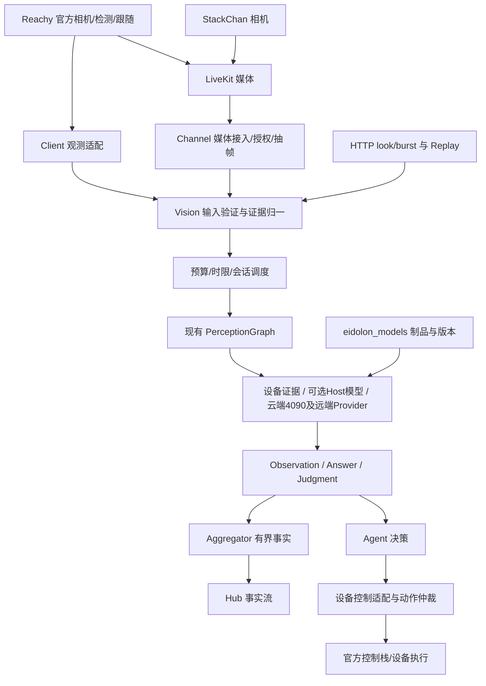

# 通用视觉能力中心：架构评审稿

日期：2026-10-31。源码基线：eidolon_vision 7591cf4。仅设计与只读研究；没有运行模型、采集设备、调用付费推理、部署或修改生产实现。性能数据注明来源；本文提出的预算均不是实测承诺。

> 2026-11-05：跨系统实施顺序、Reachy体验与手机人脸档案衔接以[整体方案](eidolon-visual-interaction-plan-2026-11-05.md)为准。本文保留通用Vision模型与运行框架设计。按需图片优先LiveKit字节流或复用已有视频帧；连续观察使用视频轨道。

## 1. 推荐决策

保留现有 PerceptionGraph、能力注册和适配器，补齐证据契约、会话生命周期、资源调度与 Provider。不要新造 DAG 平台，不把 Vision 变成机器人控制系统，也不把每个模型变成一个业务能力。

能力描述“做什么”，模型描述“如何做”，Provider 描述“在哪里运行”。同一个 detect.objects 可以由设备报告、Host YOLO 或远端服务实现，但语义、质量、新鲜度与许可必须满足要求，不能仅凭相同 role 互换。

部署策略（用户2026-10-31确认）：新增模型若需要验证，优先部署到用户已有的云端4090，通过远端Provider接入；不要求先在Eidolon Host逐一安装和验证。Host保留会话、授权、抽帧、调度和结果处理。当前仅更新方案，不启动云端部署。

首批实施：授权抽帧 + 现有 OCR/VLM + 单个检测器 + 会话隔离。D3 做影子结构化判断。YOLO-UniOW 与 MobileSAMv2 暂作对照实验，不同时铺开。

## 2. 当前实现与具体缺口

本地证据链接均指当前工作区，后续源码变化应重新核验。

| 证据 | 核验结论 | 建议 |
|---|---|---|
| [ports.py](../../eidolon_vision/runtime/ports.py)、[types.py](../../eidolon_vision/runtime/types.py) | Source/Gate/Perceptor/Tracker/Aggregator/Interpreter/Sink 已存在；Observation 只有标量、单框、标签和 track_id | 保留端口，新增版本化结果联合类型；不要把 mask、OCR 区域和概率分布塞入 metrics |
| [graph.py](../../eidolon_vision/runtime/graph.py) | observe/ask 已分开；聚合 key 是 capability:owner:device，没有 epoch；Tracker 是 graph 共享实例 | 按租户、设备、stream、session、epoch 隔离状态，释放/过期；Tracker factory 代替共享有状态实例 |
| [bootstrap.py](../../eidolon_vision/app/bootstrap.py) | 只绑定 presence、face_metrics；OCR 与云 VLM 可选；未绑定 Tracker | objects/identity 只是角色词汇，不是已交付能力；发布 capability ready/reason |
| [http.py](../../eidolon_vision/app/http.py) | burst/look 解码图片；look epoch=0；上传 read 没有这里可见的大小上限；audit 直接读日志，无路由内鉴权 | 限字节、像素、帧数、解码时间；绑定会话代次；审计按 Owner 授权分页，禁止全文件读取 |
| [auth.py](../../eidolon_vision/runtime/auth.py) | 校验签名、受众、过期和 trigger；UploadGrant 没有外发和会话撤销语义 | 签名委托增加 purpose、session/epoch、目的地与预算；撤销状态在执行和结果提交前验证 |
| [graph.py](../../eidolon_vision/runtime/graph.py) | 同步 infer 在 async observe 内执行；ask 仅 CannotAnswer 触发后续候选；observe 审计写死 egress=False | 重推理放有界 worker；区分超时/OOM/不可用；外发从实际执行路径汇总 |
| [frame_diff_presence.py](../../eidolon_vision/adapters/perceptor/frame_diff_presence.py) | 差分被用作 presence | 降为 change gate；机器人转头/曝光变化不能认定人在场，静止不等于无人 |

没有证实完整 LiveKit 消费链路。Source 抽象存在不等于实际入口使用它。现有模型字段不足以证明制品版本、预处理和执行位置均可审计。Gate 注释“设备 gate 总更好”也需修正：端侧过滤若丢失证据会损害召回，必须由业务预算决定。

## 3. 模型身份与取舍

### 明确对象

- d3：用户提供的 [服务文档](/Users/manson/ai/decider/delta_router_eval/docs/decider-api-usage.md) 明确为 Decision 3.0 27B，匹配 [官方 vllm-sr/d3 模型卡](https://huggingface.co/vllm-sr/d3)。不采用搜索到的第三方镜像作为权威。
- yolo-uniow：对应 [THU-MIG/YOLO-UniOW](https://github.com/THU-MIG/YOLO-UniOW)。
- mobilesam v2：对应 [MobileSAM 仓库的 MobileSAMv2](https://github.com/ChaoningZhang/MobileSAM)，不是 SAM 2，也不能据名称推断有视频记忆。
- neolink：用户已确认 [Neolink Token Switch](https://www.neolink.com/)，与 Reolink 摄像头代理同名项目无关。

### 候选矩阵

下表部署与优先级是架构判断；未在本项目硬件测量。仓库许可证只是入口，权重、依赖与导出产物应分别登记，不能把部署成独立进程当成免除许可义务。

| 候选/来源 | 输入 → 输出；能力 | 部署/资源与成熟度 | 许可与选择 |
|---|---|---|---|
| [YOLO-World](https://github.com/AILab-CVC/YOLO-World) | 图像+文本词汇 → 框/类别/分数；开放词汇检测 | 用户云端4090优先验证；有部署目录与多个版本，工程材料相对完整；CPU/ONNX/目标 NPU 必须单独验证 | 仓库 GPL-3.0；优先作物体定位基线，固定具体 v2 等配置与权重，不能把“World”当万能识别 |
| [YOLO-UniOW](https://github.com/THU-MIG/YOLO-UniOW)、[论文](https://arxiv.org/abs/2412.20645) | 图像/词汇与开放世界配置 → 已知/未知目标框；开放词汇与开放世界检测 | 官方 S/M/L 7.5M/16.2M/29.4M；官方 V100 FPS 不可换算成 Pi 性能；研究实现，部署生态需验证 | 仓库 GPL-3.0；仅在 unknown 检测有明确需求时与 World 对照。未知框不提供未知物体名称 |
| [MobileSAMv2](https://github.com/ChaoningZhang/MobileSAM)、[论文](https://arxiv.org/abs/2312.09579) | 图像、物体感知提示 → masks；加速 segment everything | PyTorch 研究流程；优先云端4090按需分割，不能假设 mobile 就能在 ESP32 实时跑 | 顶层 Apache-2.0；v2 携带检测组件/依赖需逐项核验。用于精细 ROI、轮廓，不替代检测、身份和持续跟踪 |
| [D3](https://huggingface.co/vllm-sr/d3) | 文本/JSON+图片/视频+问题 → choice/noul/score 与概率；结构化多模态判断 | 官方卡 26.09B，独立大模型服务；现有远端服务优先，近期模型须锁定版本与回归集 | 模型卡 Apache-2.0；适合事件候选判断、是否值得深入理解；不是自由回答器、检测框模型或 VLA |
| RapidOCR（现有适配器） | 图像 → 文字，未来增加文字框和置信度 | 本地按需，现有代码可复用；字小/模糊/反光需要验收 | 精确安装版本及权重许可待制品登记；读纸优先，不回答空间关系 |
| MediaPipe/YuNet | 图像 → 脸/关键点/面部指标 | 前者现有 Host 适配；后者 Reachy 官方 daemon 内运行 | 继承并核对实际软件/权重许可。脸跟踪不等于身份、说话人或疲劳结论 |
| Neolink 视觉 VLM（下节） | 图片+问题 → 文本/结构化回答 | 远端 API，需网络、额度和外发；平台供应不代表每个模型功能相同 | 商业服务条款、模型规则及数据政策分别核对；适合 describe，不能作为低延迟运动闭环 |

### D3 具体适配

按用户文档：HTTPS POST `/d3/v1/systemone`，model 必须为 `d3`，images 使用 base64 data URL；videos 支持视频 data URL。choice/noul/score 应保留原始分布与 question_schema_version。服务文档报告视频抽样 2 fps、最多32帧，单视频32 MB/300秒、网关64 MB；这些是该服务记录的约束，不能当成所有 D3 部署的固有能力。接入时用小型合成图/视频重新做协议验收。

用户文档中的80–120 ms是特定服务文字推理口径，图片约250–600 ms等数据也来自2026-10-24既有记录，本轮没有复测。不要统一采用“概率0.8就可信”；对视觉任务独立做校准、拒答与错误成本评测。pplx 会忽略 videos，不能作为视频任务的透明备用服务。512缩图只作为D3初始配置，不能迁移到需要保留小字的OCR。

D3 接入新增 `StructuredJudge` 端口或等价明确接口；输入 EvidenceBundle + QuestionSet，输出 Judgment。只对有收益的低频事件调用，不能为了路由一次便宜检测先调用27B模型。

### Neolink 可核查目录

[官方套餐目录](https://www.neolink.com/docs/token-plan-enterprise/token-plan-enterprise-overview) 标注下列视觉理解型号：

| 型号 | 建议用途 | 尚未核实 |
|---|---|---|
| deepseek-v4.1-flash；deepseek/deepseek-v4-flash-vision-exp | describe 候选；exp 只做影子实验 | 图片数、分辨率、结构化输出和版本稳定性 |
| kimi-k2.7-code；kimi-k2.6 | 复杂场景问答候选 | 视频/时序能力不能从 vision 标签推断 |
| qwen3.8-max、qwen3.8-flash；qwen3.7-plus/flash；qwen3.6-plus/flash | 质量/成本配对比较 | 当前账号可用性、实际延迟和额度 |

这是平台公布清单，不是本轮验证过的实际可用模型。平台将部分其他型号标为文本模型，不能因为品牌支持视觉就自动开放图片。图像/视频生成模型不进入感知主链路。

按[官方个人指南](https://www.neolink.com/docs/userbook/03-personal-guide)，模型广场和 Key 分组决定可用范围、端点与计费；实施时读取获授权账号的模型列表/详情，形成白名单。未使用用户 Key、未登录、未发生收费调用。用独立 Neolink Provider 复用 CloudVlmInterpreter 的语义，不把型号列表硬编码在能力模块里；请求协议适配必须逐型号验证，不能假设所有接口都等价。

## 4. 分层与数据流

Channel 管媒体会话、轨道订阅与时间映射；Vision 管帧质量、推理、证据和任务。不要让多个能力重复订阅解码同一轨道。首期 Source 接收已授权 FrameRef，不另建媒体服务。

Reachy 保留官方 YuNet、跟踪、几何与电机闭环；只有公开观测接口可用才上报，不读取私有内存。client 通过官方跟随开关/权重协调显式动作。StackChan 由 Host 检测/跟踪输出图像坐标目标，控制适配负责相机标定、关节映射、限速与停止。模型与硬件替换不会改变目标语义，但标定和实际延迟必须重新验收。

## 5. 统一契约与权威边界

在 eidolon_sdk 扩展现有契约，runtime 内部 dataclass 保持轻量。建议字段而非本轮发布的新协议：

- Request：schema_version、request_id、owner/tenant、device、stream、session、epoch、purpose、intent、deadline、max_frame_age、授权引用、允许位置/目的地、预算。
- FrameRef：frame_id、capture_ts、receive_ts、clock_domain/误差、seq、尺寸/方向/颜色空间、crop→原图变换、短期授权媒体引用；媒体访问不可跨会话。
- Observation：evidence_id、frame_id/time_range、kind、typed payload（boxes/masks/text/landmarks）、source、模型revision/制品hash/预处理版本、confidence或缺失、quality。归一坐标必须绑定原始图像和变换。
- Track：stream+epoch+track_id，带 lost/expiry；不等于 person_id，不跨摄像头自动合并。
- Fact：经显式规则和时间窗确认、含证据引用/有效期/规则版本的有限断言；unknown 与 absent 分开。
- Answer：用户问题的回答、证据范围、限制和实际外发路径；不自动写事实。
- Judgment：固定问题集的分类/概率分布、校准版本、abstain；不自动转动作。
- ActionProposal：Agent 拥有的目标/意图，引用证据和有效期；Vision 不输出舵机角度，不执行工具。

Person 权威保持现有体系，Vision 只交视觉证据。现有 [person_observation.py](../../../eidolon_sdk/eidolon_sdk/biz/person_observation.py) 已区分 visible_person 与 speaker，必须复用，不能由看到某张脸推定发言人。人脸特征注册、身份匹配授权与 Person 映射需遵循专项；不要在 Vision 建第二份身份库。

Memory 只接纳经策略选择、带 Person/Companion 范围和有效期的内容；连续帧、全部OCR、模型猜测不默认永久入库。Agent 管对话与决策；models 管制品、校验和、转换/量化元数据及可复用推理服务，Vision 管业务感知语义。依据 [models README](../../../eidolon_models/README.md)，已有固定版本和显式激活机制，直接扩展而非重复下载管理。

## 6. 实时、按需与资源管理

实时 follow/presence 保留最新帧，有界队列容量1–2作为初始实验；按需 look 绑定请求采集窗口，不能拿任意缓存帧冒充现在。短视频任务保存有界环形缓冲，记录抽帧时间；同一帧的不同模型结果用 frame_id 关联，不以完成时间关联。

设备单调时钟与 Host 时钟做映射并记录误差；缺可靠采集时间时明确 unknown。窗口不足、时间缺口和丢帧率随结果返回。禁止把多张无时间标签图片称为连续视频理解。

调度先过滤授权、输入模态、结果语义、硬件/内存和 deadline，再在可行 Provider 中按成本、排队和新鲜度选择。设备已有合格观测优先复用；新增检测模型优先在云端4090验证，通过Host调用；只有网络时延无法满足目标新鲜度等明确证据出现时，才评估迁移到Host。Reachy本地跟随继续保留；远端同时可承担授权的复杂理解。设备报告需验证签名关联、来源版本与时间，不信任任意客户端 person_score。

每租户独立并发/字节/token/金额限额，Host全局资源上限；音频优先，资源紧张降视觉帧率。过期帧和晚到结果丢弃；撤销后取消任务，无法中止远端计算时仍阻止结果进入新会话。取消不代表远端未计费。

起始评测目标（可调整，未达成）：跟踪证据年龄p95≤250ms、OCR端到端p95≤2s、VLM≤5s；若硬件不达标应公布实际能力，不能降低时间戳真实性。短视频异步任务返回 job_id，支持取消、期限和过期清理。

## 7. 插件与故障降级

CapabilitySpec 继续定义业务需求。新增小型 ProviderDescriptor：operation/schema、模态、执行位置、model revision/hash、license refs、runtime/precision、input limits、estimated memory、supports_batch/cancel、egress destinations。无需建设插件市场或任意代码热加载。

生命周期：discovered → loading → ready → draining → unloaded，失败为 unavailable(reason)。只加载显式配置制品；校验hash后预热；资源引用计数、防重复加载、空闲回收。模型切换先预热健康检查，再切新请求；旧请求固定版本，Tracker/特征空间不兼容时重置代次。

同步模型由有界线程/进程worker隔离，GPU/OOM用独立进程恢复；不要阻塞HTTP事件循环。远端连接池有并发、超时、熔断和重试预算。重试沿原deadline，避免多级回退费用失控。

降级必须同语义：OCR失败可经授权换OCR/VLM，但标明提取方式；describe不可回退为纯OCR；视频不可回退给会忽略视频的模型；外发不允许时只能本地或明确 unavailable；检测无结果不等于不存在。状态与失败也要审计，不能只记录成功。

## 8. 隔离、授权、审计

状态key使用结构化tuple，包含tenant/owner/device/stream/session/epoch/capability；结束、撤销、TTL和模型切换触发释放。所有缓存包括图像特征/词汇缓存也要考虑数据范围，不能将私有prompt跨租户复用。限制每租户状态数量与内存，防无限创建会话。

外发策略是服务端授权与请求意愿的交集，不能只信 allow_egress；签名许可绑定用途、目的地、有效期及媒体范围。LiveKit房间访问权不自动授予第三方模型外发权。插件不得绕过统一网络出口策略；图片中文字和模型回答都是数据，不能修改授权/系统指令。

审计含请求关联、证据hash、模型/规则/策略版本、目的地、时延、预算、丢帧与降级原因，默认不保存原图和完整回答；需要内容保留时明确期限与授权。日志按Owner隔离，接口鉴权/分页；清理帧、临时文件和引用，禁止宣称未验证的零保留。实际保留量应测量，不沿用硬编码 pixels_retained_ms=0 作为证据。

## 9. 最小实施阶段与验收

| 阶段 | 交付 | 验收出口 |
|---|---|---|
| P0 契约/隔离 | 更新README；修正presence语义；session/epoch状态与审计授权；签名外发策略 | 两Owner/两设备/重连/撤销测试无串流、无越权和旧结果；请求大小/解码限制有效 |
| P1 媒体到现有能力 | 单轨道授权抽帧、OCR与现有VLM；fake/replay与资源worker | 读纸/描述可回放；记录新鲜度与端到端延迟；离线/超时明确失败；音频并发不显著退化 |
| P2 一条定位链 | 云端4090部署YOLO-World或更合适检测器二选一；Host远端Provider；隔离Tracker；StackChan目标契约 | 静止人、转头、曝光、遮挡、多人、断线；ID切换和目标陈旧停止；不直接生成舵机命令 |
| P3 结构化理解 | D3影子Judge；Neolink选择一个实际账号可用VLM | D3概率校准与拒答；视频确实消费；云模型故障不越权回退；质量/成本胜过基线才启用 |
| P4 可选能力 | UniOW unknown对照、MobileSAMv2按需分割、时序事件 | 只有具体用例证明收益才接入；不以模型数量验收 |

评测集按设备、场景和身份隔离训练/验证；使用获授权或合成素材，不收集机器人数据。先用Replay与获授权素材调用云端4090，分别测模型耗时和网络端到端耗时；现有本地适配器可作对照，不要求所有模型先在Host运行：清晰/小字/反光、昼夜/背光、运动/曝光、无人/静止/遮挡、多目标交叉、时序顺序反转、画面提示注入、坏图/超大图、两租户同时请求。保存制品与数据hash，保留独立测试集。

指标：框mAP/召回与误报、跟踪ID切换/丢失恢复、mask IoU、OCR CER、回答证据一致性与拒答、D3 Brier/ECE与风险-覆盖曲线；系统测capture-to-result p50/p95、队列年龄、内存峰值、丢帧、外发字节/费用、音频退化。对每个候选跑相同硬件/分辨率/并发，不引用官方GPU FPS证明边缘实时能力。

发布门槛先锁定测试目标与错误成本；授权、隔离、过期结果必须零违规。质量门槛按任务制定，不能统一confidence≥0.8。当前设计评审通过不等于这些验收已完成。

## 10. Reachy证据与未决事项

参考 [现有Reachy方案](../../../docs/reachy_mini/client/vision.md)、[媒体架构](../../../docs/reachy_mini/client/architecture.md)。本地参考提交5feff22cbe9614709b8131f3de4209d0ac24452c的 [face_detector.py](/Volumes/m/2026/ai/reachy_mini/reachy_mini/src/reachy_mini/vision/face_detector.py) 使用固定revision的YuNet；不因此假定已提供可远程读取的检测流。

实施前待定：云端4090实例连接方式、显存/驱动/运行时与资源余量；Host网络条件；Reachy公开观测出口；Neolink账号实际模型/协议/数据保留政策；D3当前部署版本和服务SLA；具体YOLO与分割制品许可组合。它们影响插件选择与预算，不阻塞上述边界设计。

推荐评审顺序：先确认Vision不拥有身份和动作权威，再确认会话/证据契约，最后选择首个检测器与VLM。优先把三条真实链路做可靠：读纸、回答画面问题、给低算力设备提供新鲜目标位置。

## 11. Reachy产品体验补充：多人跟踪与camera工具

### 多人出现时的实际行为

当前参考 [Tracker源码](/Volumes/m/2026/ai/reachy_mini/reachy_mini/src/reachy_mini/vision/face_tracking.py) 跟踪一个目标，不是同时朝向多个人：

1. 没有目标时，选择检测框面积最大的脸，并检查最小面积阈值。大脸可能对应较近的人，但不是深度测距。
2. 已有目标时，选择鼻子归一图像坐标最靠近上一目标位置的脸，并检查最大跳变阈值；不会每帧重新选最大脸。
3. 未检出或目标跳变过大时累计miss。默认连续超过20次miss才清除关联，下一次重新按最大脸选取；这是处理次数，不是固定20秒。
4. 只有位置关联，没有身份重识别。两人交叉、遮挡、原位置被另一张脸占据时可能换人；不会自动认主人，也不会自动转向当前发言者。

产品语义应写“跟随当前选中的人脸”，不能写“始终跟随正在说话的人”。Eidolon若需要多人注意力选择，单独设计TargetSelector：明确用户指定优先、现有目标保持、丢失后重选与切换冷却；发言人驱动切换必须有声画关联证据。它输出target引用，不写Person身份或舵机参数。不要因设计TargetSelector而默认重写Reachy官方跟随；精确指定目标是否有公开控制入口需另行验证。

### camera确实是LLM可调用的工具

[Camera工具](/Volumes/m/2026/ai/reachy_mini/reachy_mini_conversation_app/src/reachy_mini_conversation_app/tools/camera.py) 的名称是camera，参数为question。对话LLM根据“看一下”“我手里是什么”等意图调用；工具从官方媒体接口取当前JPEG，返回base64图像，再交所选多模态对话后端理解。工具函数本身没有完成物体识别；不是每次调用都另启动独立视觉模型。工具描述要求用户只说“看一下”时先看并描述，不先追问。

跟随是另一条持续本地控制链，head_tracking工具负责开启/关闭；并不需要LLM逐帧调用camera来维持注视。视觉体验由“持续注视”和“按需理解”组合。

Eidolon沿用这种用户入口：Agent的look/camera工具提交Vision请求，Vision选择抽帧与Provider，再返回Answer或结构化证据；工具不绑定YOLO、D3或某个云平台，也不自动获得外发权。一次调用优先抓取符合时限的一张图；用户询问变化/过程时才显式选择burst/video能力。

## 12. 云端4090优先的验证与部署路径

用户已有云端4090作为新增模型的首选实验算力。逻辑能力仍属于eidolon_vision，模型进程可以位于远端；物理位置不改变Observation/Answer/Judgment契约。

链路：设备 → LiveKit/Host抽帧 → Vision鉴权与调度 → HTTPS远端Provider → 云端4090推理worker → 带证据ID的结果 → Host/Agent。模型服务不订阅全部家庭摄像头，也不掌握机器人控制凭据。

- 首个候选只部署一个检测器，完成图像、词汇、框坐标、错误与版本契约；后续按收益验证UniOW/分割，避免同时驻留所有模型。
- 每个模型独立依赖环境和固定制品；worker先检查实际显存、驱动与推理框架，再预热。采用有界并发和按需加载/卸载，模型切换记录冷启动。
- D3优先复用用户现有服务，不要求另搬到4090。27B模型不能未经显存评估就宣称能以原精度单卡加载；若有自托管需求，再评估量化、上下文、视觉编码与精度回归。
- VLM优先比较现有服务/Neolink；本地权重VLM仅在有明确成本、质量或数据控制收益时增加4090实验。
- 云端由用户管理也仍然是离开Host的媒体外发。策略区分owner-managed-cloud与third-party-cloud，分别绑定授权、目的地、凭据与保留期限；远端服务需认证、传输保护和租户隔离。
- 测量拆分：抽帧/编码、上传、服务排队、GPU推理、下载/后处理、端到端；同时记录输入分辨率、显存峰值、并发、冷/热启动和网络抖动。不能拿GPU推理快推断转头体验流畅。
- 网络故障/过期结果使目标失效，设备控制层按策略停止或保持安全姿态；禁止云端超时后追赶旧目标。Reachy官方本地跟随不依赖云端可用性。

验证顺序：离线合成/授权素材与协议验收 → 4090模型质量基线 → Host远端调用与网络故障回放 → 获授权的设备端到端体验。只有在成本、离线、隐私或网络时限明确要求时，才另开Host CPU/NPU/本地GPU迁移任务。迁移复用同一契约与测试集，不是初始验收前置条件。
